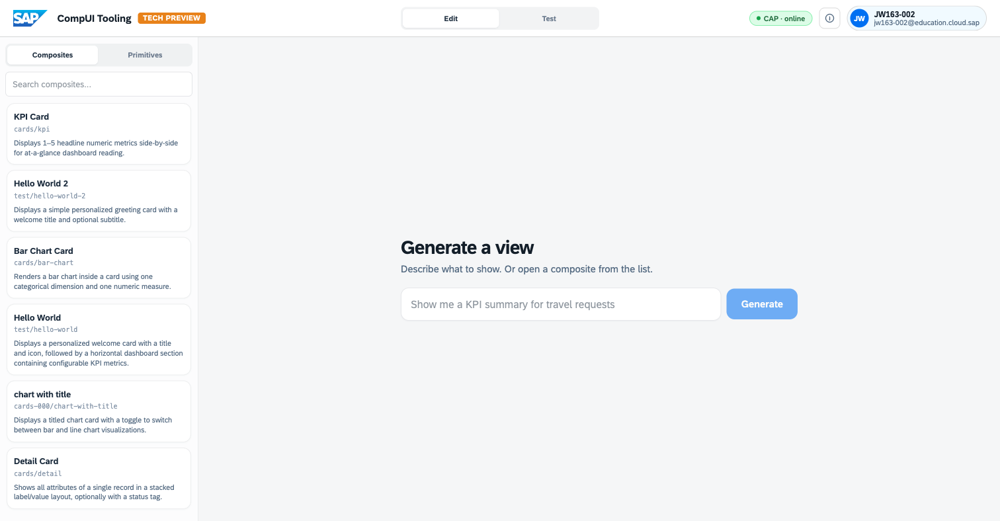
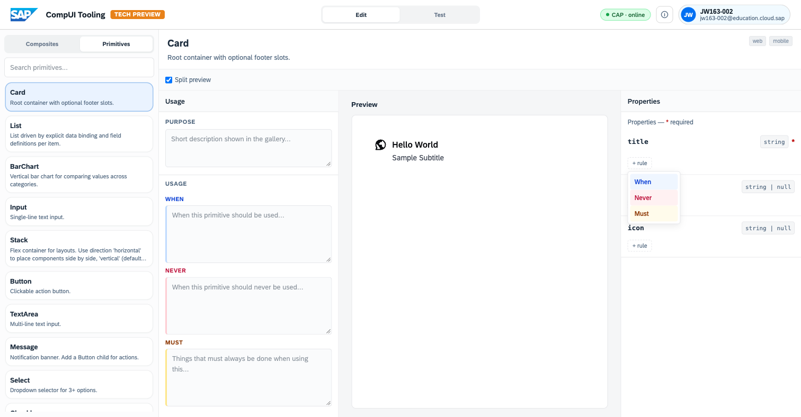
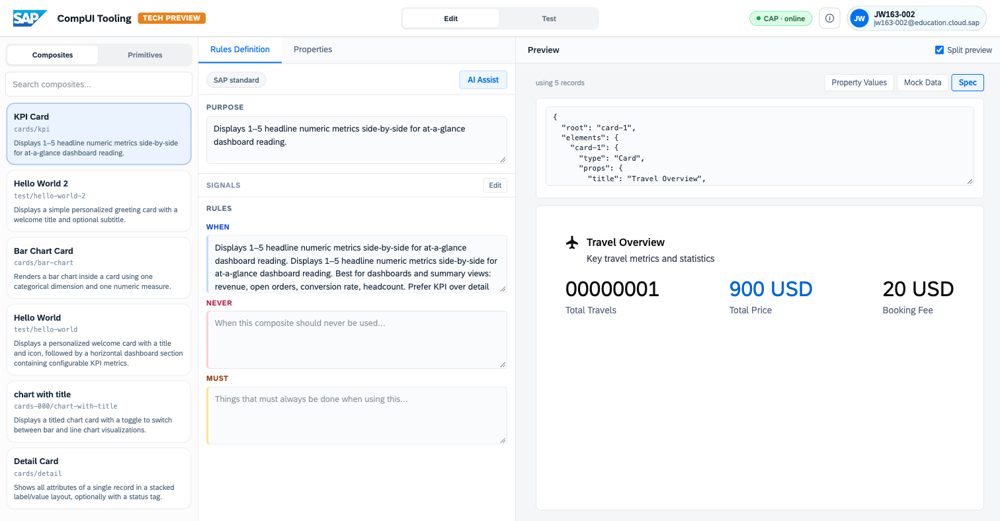

# Exercise 1 – Explore the Workbench

Get oriented in the **CompUI Tooling** and learn the three concepts the whole
system rests on: **primitives**, **design knowledge (rules)**, and
**composites** — and the single **spec** they all reduce to.

> **Tool:** <https://compositional-ui-tooling.cfapps.eu10-005.hana.ondemand.com/>
> **Dataset:** the standard SAP **SFlight** travel scenario (travels, bookings, agencies, prices, status).
> **Format:** work through each step at the screen as you read.

> **A note on names.** The screens say *CompUI Tooling*, *Generate a view*,
> *Reasoning flow*, *Used composite*. In the broader Compositional Design System
> (CompDS) these map to the *playground / generation service*, the
> *JSON-render spec*, and *design knowledge* (the project's preferred name for
> what the UI calls **rules**). This guide uses the **on-screen labels**
> throughout so what you read matches what you click; the conceptual names
> appear only where they aid understanding.

## The core principle

> **The user describes *what* they want to see; the system determines *how* to
> present it** — by selecting a pre-approved building block (a **composite**),
> populating it with the data, and rendering it. The output remains on-brand
> because every building block ships with the rules that govern its use.

Keep this "**what vs. how**" distinction in mind — the whole session is a
sustained demonstration of it.

---

## 1.1 Orient: the three panes

When you land, you're in the **Edit** workspace. Three regions:

- **Left — Catalog.** Two tabs: **Composites** and **Primitives**. This is the library of building blocks the system is allowed to use.
- **Centre — the prompt.** "**Generate a view** — Describe what to show. Or open a composite from the list."
- **Top bar — the SAP logo** (doubles as *Go to home*), the **Edit / Test** switch, and the `CAP · online` status.



**Key point.** Everything the system is allowed to build from lives in the left-hand Catalog. It cannot invent components — it composes only what has been approved. This is the guardrail that keeps generated UIs on-brand.

---

## 1.2 Explore the Primitives

Click the **Primitives** tab in the left panel.

Primitives are the **smallest atomic building blocks** — a `Card`, a `Table`, a `Metric`, a `BarChart`, a `Button`, a `Tag`, and so on (~25 of them). They are shipped as code and **cannot be altered or decomposed by the system**. They form the fixed vocabulary.

Click **`Card`** in the list. The detail view has three columns:

- **Usage** — a plain-language contract: **Purpose**, and the **When / Never / Must** guidance for the primitive.
- **Preview** — a live render of the primitive.
- **Properties** — the inputs the primitive accepts (e.g. `title` *required*, `subtitle`, `icon`), each typed.


**Try this:**
1. Open five primitives in turn — `Metric`, `Table`, `BarChart`, `Input`, `Stack` — and read each one-line description. Group them mentally into three kinds: **data display** (`Metric`, `Table`, `BarChart`), **input** (`Input`), and **layout / structure** (`Stack`). This is the shape of the vocabulary the system draws on.
2. For one data-display primitive (e.g. `Metric`), read its **Properties** and note how tightly typed and specific they are — each description states exactly one purpose ("Prominent KPI / hero number", "Semantically colored state indicator").

**Why it matters:** primitives are deliberately few and tightly described. That precision is what allows the system to choose between them reliably.

---

## 1.3 See where the rules live: the "+ rule" affordance

Still on a primitive (`Card`), look at the **Properties** column. Under each property is a small **`+ rule`** button.

Click **`+ rule`** under `title`. A little menu appears: **When**, **Never**, **Must**.



This is a core mechanism of the system — the **design knowledge** (labelled **rules** in the UI). Every building block carries rules that state:

- **When** it should be used,
- **Never** — when it must not be,
- **Must** — what always has to hold when it is.

These rules travel *with* the component into the system's reasoning. The system does not guess at good design — it is given the design knowledge and constrained by it.

> You don't need to author a rule here — just see that rules are attached at the property level, not written in some separate document. **Close the menu** (click elsewhere) and move on.

---

## 1.4 Open a Composite and read its rules

Switch the left tab back to **Composites**.

Composites are **built from primitives (and other composites)** and expressed as a **spec, not code** — so they are **extensible**: the catalogue can grow without shipping new code. The list shows the SFlight-oriented set: **KPI Card**, **Table Card**, **List Card**, **Detail Card**, chart cards, **Sales Order View**, **Space Page**, and more.

Click **`KPI Card`** (`cards/kpi`). The composite editor opens with two sub-tabs — **Rules Definition** and **Properties** — plus a live **Preview**.

Look at **Rules Definition**:
- A **`SAP standard`** badge (top-left) — this composite is a vetted, standard-layer building block. There's also an **AI Assist** button for drafting rules.
- **Purpose** — the gallery description.
- **Signals** — hints that help the system match a request to this composite.
- **Rules** — the **When / Never / Must** design knowledge, in prose. Read the **When** box: *"…Best for dashboards and summary views: revenue, open orders… Prefer KPI over detail when the user needs a numeric snapshot… Prefer KPI over table when there are very few metrics (≤5)…"*


Read the **When** text as the selection criteria the system applies: it instructs the system to prefer a KPI card over a table when there are five or fewer metrics. This is why, later in the session, "show me a summary" produces KPIs and "show me a table" produces a table — from the same underlying data.

The Preview already shows live SFlight data: **"Travel Overview"** with *Total Travels / Total Price / Booking Fee*. The composite is not a static mock — it is bound to the live travel dataset.

---

## 1.5 Reveal the spec: one declarative artefact

In the composite's **Preview** header, find the toggle **Property Values · Mock Data · Spec**. Click **Spec**.

The preview swaps for a block of JSON:

```json
{
  "root": "card-1",
  "elements": {
    "card-1": {
      "type": "Card",
      "props": { "title": "Travel Overview", … }
    }
  }
}
```



**Why it matters:** this JSON **is** the composite. It references primitives by `type` (`Card`, `Metric`…), carries the data bindings, and is the single hand-off artefact. The *same* spec format is used whether a composite is hand-built or system-generated — and the *same* spec can be rendered to web, mobile, or other surfaces. **One spec → many surfaces.** This is the "how" made concrete.

Toggle back to **Property Values** when you're done.

---

## Summary

You now know the four concepts the rest of the session builds on:

- **Primitives** — the fixed, atomic, code vocabulary.
- **Design knowledge (rules)** — the **When / Never / Must** guidance that ships with every building block.
- **Composites** — extensible building blocks expressed as a spec, not code.
- **The spec** — the single JSON-render artefact a renderer turns into UI.

Continue to **[Exercise 2 – Author and Generate](../ex2/2_AuthorAndGenerate.md)**, where you make the system generate views and author a new composite of your own.
