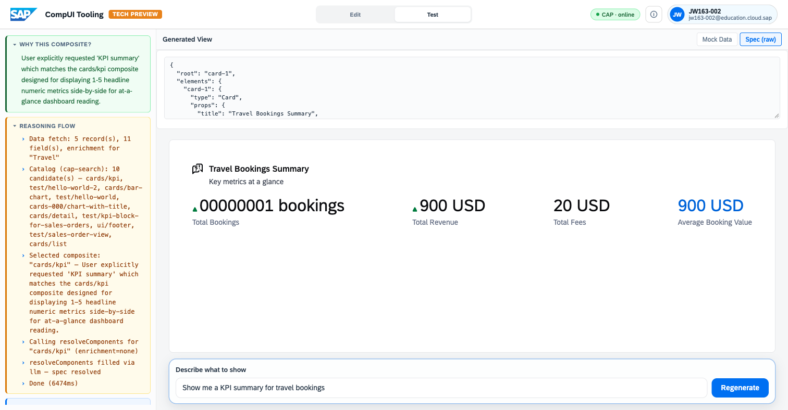
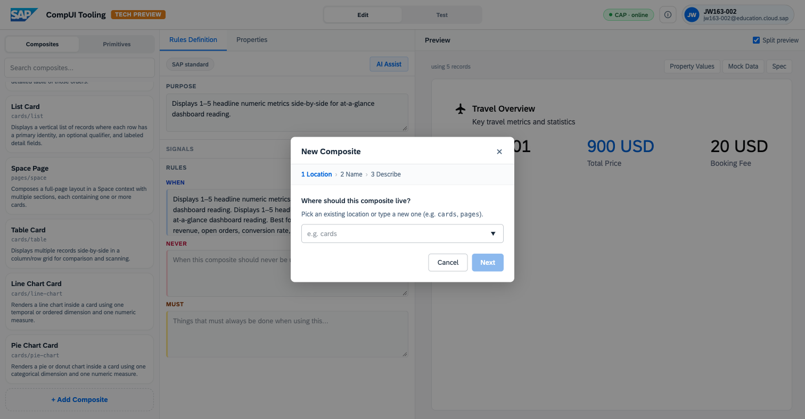
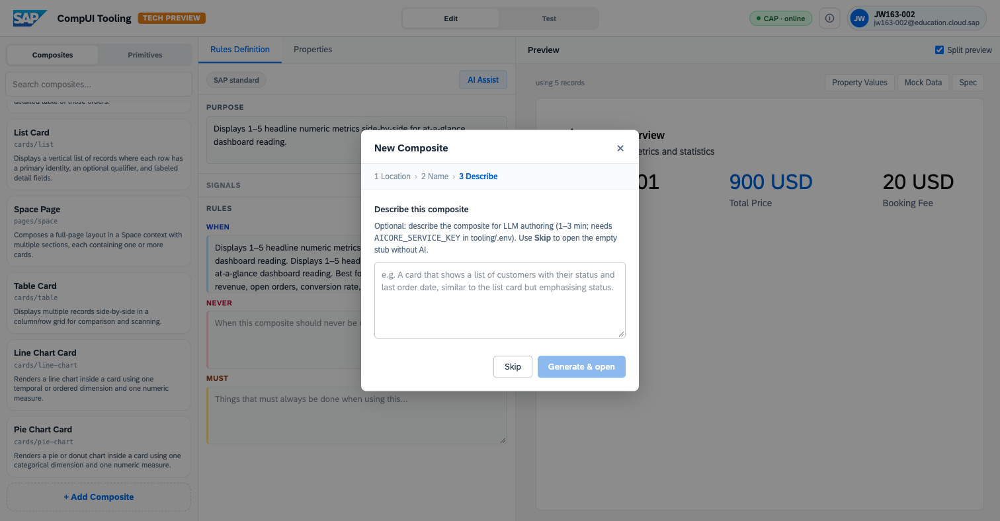
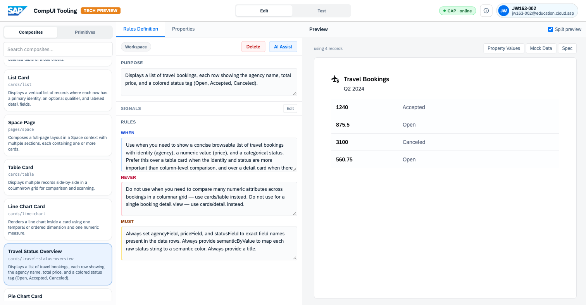

# Exercise 2 – Author and Generate

Now make the system work. You'll generate a finished, data-bound view from a
plain-language prompt, watch it choose a different composite when the request
changes, author a brand-new composite from a description, and then see the
system select your new composite in a later generation.

> **Prerequisite:** [Exercise 1 – Explore the Workbench](../ex1/1_ExploreTheWorkbench.md).
> **Tool:** <https://compositional-ui-tooling.cfapps.eu10-005.hana.ondemand.com/>

---

## 2.1 Generate your first view

Click the **SAP logo** (top-left) to go to the **Generate a view** prompt.

In the prompt box, type:

```
Show me a KPI summary for travel bookings
```

Click **Generate**. After a few seconds the tool switches to the **Test** workspace and shows the result.


Three areas to review, in order:

**(a) The result (centre).** A card titled **"Travel Bookings Summary"** with four KPIs — *Total Bookings, Total Revenue, Total Fees, Average Booking Value* — populated with live SFlight numbers. A described intent has produced a finished, data-bound view.

**(b) "Why this composite?" (top-left, green).** A one-sentence justification: *"User explicitly requested 'KPI summary' which matches the cards/kpi composite designed for displaying 1–5 headline numeric metrics…"* — the plain-language rationale for the choice.

**(c) "Reasoning flow" (left, yellow).** A step-by-step trace of how the view was built:

1. **Data fetch** — 5 records, 11 fields, enrichment for "Travel".
2. **Catalog (cap-search)** — 10 candidate composites considered (cards/kpi, cards/bar-chart, cards/table, …).
3. **Selected composite** — `cards/kpi`, with the stated reason.
4. **resolveComponents** — the composite's slots filled.
5. **Spec resolved** — the JSON-render spec produced.
6. **Done** — with timing (e.g. ~6 s).

This is the transparency mechanism. The output is accompanied by the data that was retrieved, every composite that was considered, the one that was selected, and the reason for the selection. For organisations concerned with provenance — "where did this come from?" — the trace provides the answer.

Expand the **Used composite** tree (left, below the reasoning) to see the composition hierarchy: **KPI Card → Card → Metric (×4)**.

---

## 2.2 Same data, different request

Keep the generated view on screen. In the **Describe what to show** box at the bottom, replace the text with:

```
Show me a table of all travel bookings with status
```

Click **Regenerate**.


What changed:

- The **Reasoning flow** now reads **Selected composite: `cards/table`** — *"User explicitly requested 'a table' and table cards are best for lists of homogeneous items where the user needs to scan across attributes…"*
- The **result** is a full table — *Travel ID, Agency, Customer ID, Start Date, End Date, Total Price, Status* — with live rows: *Hot Socks Travel (Open), Sunny Sunny Sunny (Accepted), Your Choice (Canceled)…*

The underlying data did not change. Only the request changed — and the design knowledge in the catalogue steered the system to a different, equally on-brand composite. This is the separation of **what** (the request plus the data) from **how** (the composite plus its rules).

> **Optional:** click **Spec (raw)** (top-right of the generated view) to confirm it is the same JSON-render format seen earlier on the composite in Exercise 1 — here authored by the system rather than by hand.



---

## 2.3 Author a new composite from a description

So far the catalogue has been fixed. This step shows that the catalogue itself is **extensible** — a new composite can be authored from a plain-language description, and the system drafts its structure *and* its rules.

Switch to the **Edit** workspace. At the bottom of the **Composites** list, click **`+ Add Composite`**. A three-step wizard opens: **Location → Name → Describe**.

1. **Location** — where the composite lives. Enter `cards` and click **Next**.
2. **Name** — the display name. Enter `Travel Status Overview` and click **Next**.
3. **Describe** — a plain-language brief for the composite.



In the **Describe** step, enter:

```
A card showing travel bookings as a list, each row with the agency name,
the total price, and a colored status tag (Open, Accepted, Canceled).
```



Click **Generate & open**. (This step calls the LLM and may take up to a minute.)

The new composite opens in the editor, fully formed:

- **Purpose** and a **Workspace** badge — distinguishing a user-authored composite from the **SAP standard** layer. A **Delete** control is available because it is user-owned.
- A complete set of **When / Never / Must** rules, drafted by the system — note that it has reasoned about neighbouring composites (e.g. *Never: "…use cards/table instead… use cards/detail instead"*) and about data binding (e.g. *Must: "Always set agencyField, priceField, and statusField… provide semanticByValue to map each raw status string to a semantic color"*).
- A **live Preview** rendering real SFlight data as a status list.



**Why it matters:** authoring a composite is itself a generation task. The output is not loose code — it is a composite in the same spec format as every other, complete with the design knowledge that will govern its future selection. The catalogue grows without a code release.

> **If `Generate & open` is disabled:** the authoring LLM is not configured on the tenant (the Describe step notes it needs a service key). Use **Skip** to create an empty stub, or just read along — the generated composite above is representative.

---

## 2.4 Close the loop: your new composite is selected

Return to the **Generate a view** prompt (SAP logo) and enter a request matching the composite you just authored:

```
Show me travel bookings as a list with their status
```

Click **Generate** and read the **Reasoning flow**.


- The **Catalog (cap-search)** candidate list now includes **`cards/travel-status-overview`** — the composite you created.
- The **Selected composite** is `cards/travel-status-overview`, with the reason citing its purpose: *"…which matches the Travel Status Overview composite's purpose of showing a concise browsable list of travel bookings with identity (agency), a numeric value (price), and a categorical status."*

This closes the loop: a composite authored by description in step 2.3 is, without any further configuration, a first-class candidate the system can select — demonstrating that **authoring and generation are two ends of the same catalogue**.

---

## Summary

- A plain-language prompt yields a finished, **data-bound** view, with a full **Reasoning flow** explaining the choice.
- The **same data** renders differently when the **request** changes — *what* vs. *how*.
- A **new composite** can be authored from a description, rules and all.
- That new composite is immediately **selectable** by the generation flow.

Continue to **[Exercise 3 – Explore on Your Own](../ex3/3_ExploreOnYourOwn.md)** for open-ended prompts and challenges.
