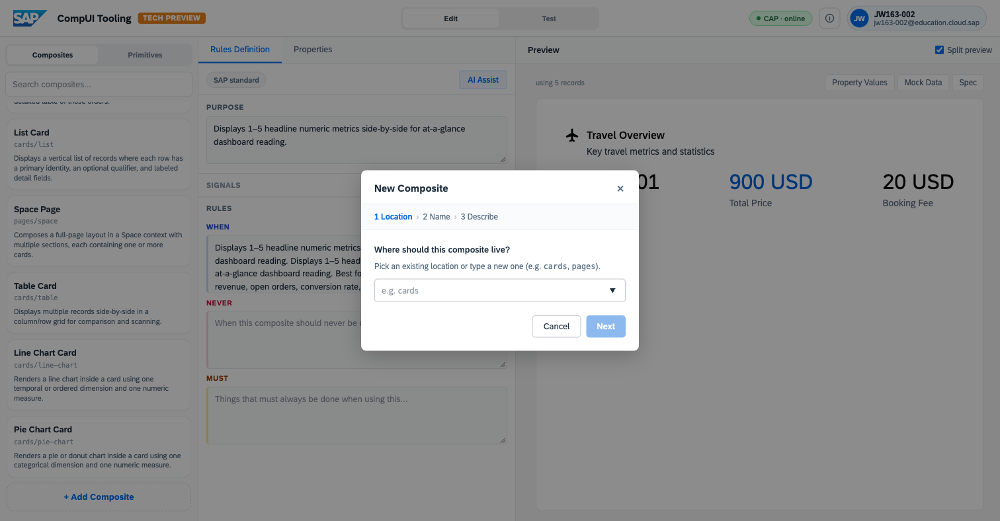
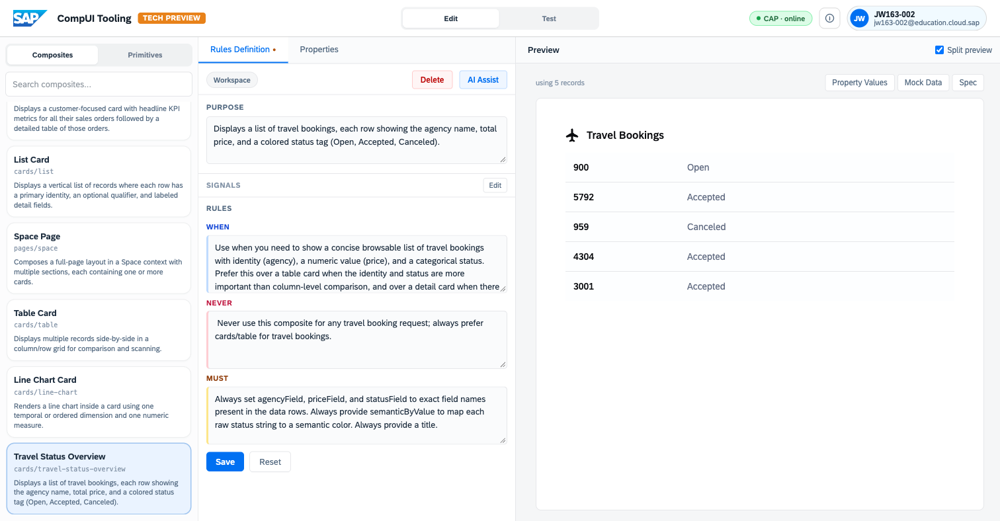

# Exercise 3 – Explore, Test, and Improve

From here, you drive. This extension lab turns the ideas from Exercises 1 and
2 into experiments: predict what the system will do, inspect why it happened,
change the design knowledge, and test whether the result improves. Most steps
run against the SFlight data from the **Generate a view** prompt.

> **Prerequisite:** [Exercise 2 – Author and Generate](../ex2/2_AuthorAndGenerate.md).
> **Tool:** <https://compositional-ui-tooling.cfapps.eu10-005.hana.ondemand.com/>

For a shorter route, complete **3.1–3.3**. Continue through the remaining
sections for the full extension lab.

## 3.1 Prompt comparison lab

Run the prompts below one at a time. Before clicking **Generate**, consider
which composite is likely to be selected. Afterwards, inspect the actual
composite and its reason in the **Reasoning flow**. Results can vary between
runs; the important part is whether the trace supports the choice.

| Prompt | Signal to watch |
| --- | --- |
| `Show me total revenue across all travels` | One headline value |
| `Compare total price by agency` | Categorical comparison |
| `Show the trend of bookings over time` | Time-based series |
| `List every booking with its status` | Scannable collection |
| `Give me a full overview of travel bookings` | Broad, multi-section request |

Now create two more pairs of prompts:

1. Two differently worded requests that select the **same** composite.
2. Two similar requests that select **different** composites.

Edit and regenerate each pair until you can see which words preserve or change
the selected composite.

## 3.2 Inspect the reasoning

Select one generated view and inspect these details in the left-hand panels:

1. How many **records** and **fields** were fetched?
2. Which composites were considered, and which one was selected?
3. What was the one-sentence reason for the selection? Do you agree with it?
4. Which primitives appear in the **Used composite** tree?
5. How the panels connect the request, fetched data, selected composite, and
   rendered primitives.

## 3.3 Trace a result through its rule and spec

Use the same generated view to trace one visible element all the way through
the system.

1. In **Used composite**, expand the tree and choose one primitive that you can
   see in the rendered result, such as a `Metric`, `Tag`, `Text`, or `Table`.
2. Click **Spec (raw)** and find that primitive in the generated spec. Identify
   at least one value or data-binding path that feeds it.
3. Return to **Edit → Composites**, open the selected composite, and read its
   **Purpose / When / Never / Must** rules.
4. Find the rule that best explains the selection. Then find one rule that
   distinguishes this composite from a neighbouring candidate.

Move between **Test**, **Spec (raw)**, and **Edit** until you can follow the
continuous path: **request → rule → composite → primitive → data**.

## 3.4 Composite design challenge

Author a second private composite. Choose one of these briefs or invent your
own:

- **Booking Exception Card** — focus attention on open or cancelled bookings,
  showing the booking, agency, price, and status.
- **Agency Performance Card** — combine a headline total with a ranked view of
  agencies and a breakdown by booking status.
- **Your own scenario** — solve a clear business question using the SFlight
  data, but make the shape reusable beyond travel.

In **Edit → Composites**, click **`+ Add Composite`**, use `cards` as the
location, give the composite a clear name, and describe it in plain language.
In the description, include the business question, visual structure, when the
composite should win, and when it should not be used.
Click **Generate & open**, then inspect the result.

Check the generated composite against this rubric:

- **Purpose** states one clear job.
- **When** contains observable signals that the matcher can use.
- **Never** distinguishes it from neighbouring composites.
- **Must** defines the important structural and data-binding constraints.
- **Preview** and **Spec** match the intended visual structure.
- The composite is reusable and not overfitted to one travel record.

Finally, return to **Test**, enter the prompt that should select your
composite, and confirm whether it appears in the candidate list and wins the
selection. If it loses, use the trace to decide whether the prompt or the rules
need to be more precise.

> If **Generate & open** is unavailable, use the **Object Card** from Exercise
> 2 for the remaining activities.

## 3.5 Run an A/B rule experiment

Use a **Private (only you)** composite, such as **Object Card** from Exercise
2. Change only one rule so you can attribute any difference to that edit.
Never edit an SAP-standard composite.

1. Run these baseline prompts and inspect the selected composite and reason:
   - `show me a comprehensive view on travel 00000001`
   - `show travel 00000001`
   - `list all travel requests`
2. Open the private composite in **Edit → Composites**. Strengthen one **When**
   or **Never** rule. For example: *"Never use this composite for collections
   or for records without a child association; prefer cards/detail."*
3. Click **Save** and rerun the same three prompts.
4. Compare A (before) with B (after): did the candidate list, selection reason,
   or selected composite change?
5. Restore the original rule using **Reset**, or restore its text and click
   **Save**.

The outcome is not guaranteed to flip. Generation is non-deterministic, and a
strong prompt can outweigh a discouraging rule. The evidence to look for is a
change in how the system discusses, ranks, or selects the composite.

## 3.6 Diagnose an unsatisfactory result

Try one deliberately ambiguous or conflicting request:

- `Show me travel`
- `Give me something useful about bookings`
- `Show travel 00000001 as a table with KPIs and a trend`

Do not regenerate immediately. First inspect the data fetch, candidate list,
selection reason, Used composite tree, and result. Classify the main problem:

- ambiguous request;
- unexpected or insufficient data;
- conflict between request signals;
- unsuitable composite or rule;
- a gap in the catalog.

Change **one thing only**—the prompt, one private rule, or the available
composite—then rerun the request and compare the result and Reasoning flow. If
the result is still unsuitable, make one more targeted change in the tool.

## 3.7 Review and refine a composite

Return to the composite you created in 3.4. If authoring was unavailable, use
Object Card from Exercise 2. Review it using the rubric below.

1. Does **Purpose** describe one recognisable job?
2. Are the **When** signals specific enough to match a request?
3. Does **Never** establish useful boundaries against existing composites?
4. Does **Must** protect the intended structure and bindings?
5. Does the preview match the rules and remain reusable?

Run the ideal prompt and one **near-miss prompt** that should select a different
composite. Update one rule or the composite description, then rerun both
prompts to verify the effect in the Reasoning flow.

## 3.8 Free-form scenarios (optional)

Create your own requests using travels, bookings, agencies, customers, prices,
fees, statuses, and dates. Suggested starting points:

- `Which agencies have the most cancelled bookings?`
- `Show me the five most expensive travels.`
- `A dashboard a travel manager would want on a Monday morning.`
- `Summarise bookings by status.`

Regenerate with small wording changes and use the Reasoning flow to verify what
changed.

## 3.9 Final end-to-end challenge

Complete the full cycle once more using only the tool:

1. Enter a new SFlight request and click **Generate**.
2. Inspect the data fetch, candidates, selection reason, and Used composite.
3. Open **Spec (raw)** and trace one visible element to its primitive and data.
4. Decide whether the result could be improved.
5. If needed, refine the request or one rule on a private composite.
6. Regenerate and inspect how the reasoning and rendered result changed.
7. Reset any experimental rule edits when finished.

The closing lesson is not that every generation is predictable. It is that the
system makes its inputs, candidates, rules, structure, and decision visible
enough to inspect and improve.

When you're done, see **[Further Resources and Thank You](../overall_content/ConclusionAndResources.md)**.
